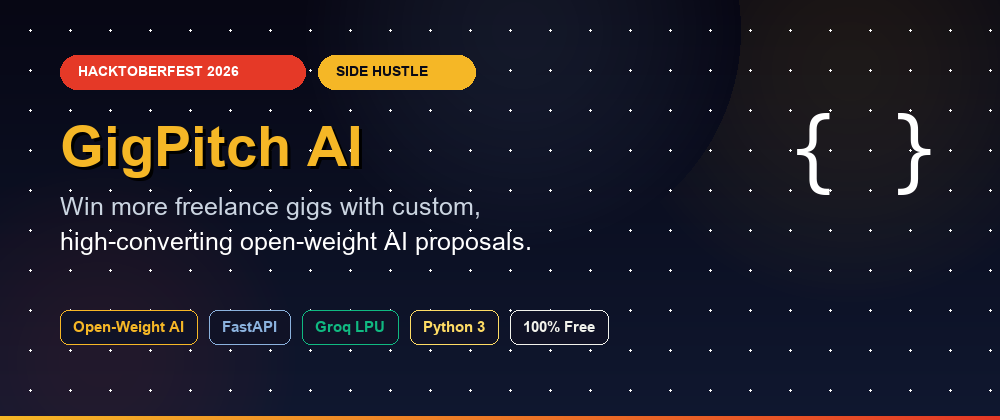
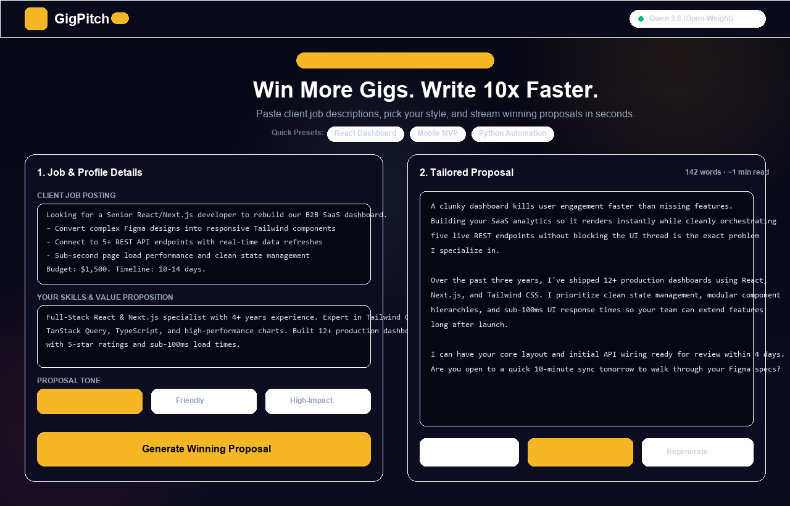
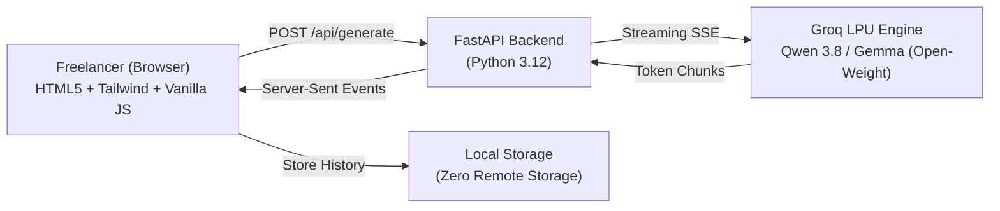

# ⚡ GigPitch AI

> **Win more freelance gigs with custom, high-converting proposals powered by open-weight AI.**

Built for the **[Hacktoberfest 2026 Open-Source AI Challenge: Week 2 (Side Hustle)](https://dev.to/challenges/hacktoberfest-week2-2026-10-12)**.



[](https://hacktoberfest.com)
[](https://opensource.org/licenses/MIT)
[](https://www.python.org)
[](https://fastapi.tiangolo.com)
[](https://groq.com)

---

## 📸 Interface Preview



---

## 🎯 The Problem

Freelancers applying on Upwork, Fiverr, and Contra face a brutal dilemma:
- **Option A:** Spend 20–30 minutes writing a deeply personalized proposal for every job posting (limits you to ~3 applications a day).
- **Option B:** Copy-paste generic templates in 30 seconds (gets ignored by 95% of clients).

**GigPitch AI solves this.** It parses any client job posting, matches it against your actual skills and background, and generates a punchy, tailored proposal in under 3 seconds.

---

## 💡 Why Open Innovation & Open-Weight AI Matters

Most commercial AI tools slap a wrapper around closed proprietary APIs and charge freelancers \$15–\$25/month:

1. **\$0 Operational Cost:** By utilizing open-weight architectures (such as Qwen 3.8 / Gemma) on high-efficiency LPUs (Groq free tier), running GigPitch AI costs literally \$0.
2. **Zero Vendor Lock-in:** The model weights are open. If a hosted provider changes their terms, GigPitch AI can transition to local inference (Ollama, vLLM) with zero code rewrites.
3. **Data Privacy:** Freelancer portfolios, rates, and client scopes stay in browser `localStorage`. Your client proposals are never used to train someone else's model.

---

## ✨ Features

- ⚡ **Instant Proposal Generation:** Streaming output in real-time.
- 🎨 **Adaptive Tone Controls:** Switch between *Professional*, *Friendly*, and *High-Impact*.
- 📋 **Preset Library:** 1-click starter templates (React Dashboard, Mobile App, Python Automation).
- ⭐ **Local History Drawer:** Save, reload, and organize your winning proposals.
- 📋 **1-Click Copy & Counters:** Live word counter and estimated reading time.
- 📱 **Mobile & Desktop Responsive:** Glassmorphism UI engineered with Tailwind CSS.

---

## 🏗️ Architecture



---

## 🚀 Quickstart

### 1. Prerequisites
- Python 3.10+
- Free Groq API Key from [console.groq.com](https://console.groq.com)

### 2. Clone & Setup
```bash
git clone https://github.com/prempathak019/gigpitch-ai.git
cd gigpitch-ai

# Create virtual environment
python -m venv venv
# Windows:
venv\Scripts\activate
# macOS/Linux:
source venv/bin/activate

# Install dependencies
pip install -r requirements.txt
```

### 3. Configure Environment
Create a `.env` file from the template:
```bash
cp .env.example .env
```
Add your Groq API key:
```env
GROQ_API_KEY=your_key_here
GROQ_MODEL=qwen/qwen3.8-27b
```

### 4. Run Locally
```bash
uvicorn backend.main:app --reload --port 8000
```
Open **[http://localhost:8000](http://localhost:8000)** in your browser!

### 5. Generate Blog Thumbnail
To regenerate the 1000x420 DEV cover image:
```bash
python thumbnail/generate.py
```

---

## 📁 Repository Structure

```
gigpitch-ai/
├── backend/
│   ├── __init__.py
│   ├── main.py              # FastAPI app and static file server
│   ├── groq_client.py       # Async streaming client for open-weight models
│   └── prompts.py           # Engineered prompt templates & few-shot examples
├── frontend/
│   ├── index.html           # Single-page glassmorphism UI
│   ├── style.css            # Custom animations, orbs, and scrollbars
│   └── app.js               # Event-driven streaming, presets, and localStorage
├── thumbnail/
│   ├── generate.py          # Python Pillow script to generate DEV cover image
│   └── thumbnail.png        # Generated 1000x420 cover image
├── .env.example
├── .gitignore
├── requirements.txt
├── render.yaml              # 1-click deployment configuration
├── LICENSE                  # MIT
└── README.md
```

---

## 🌐 Deploy to Render

GigPitch AI is pre-configured for **Render**'s free tier via `render.yaml`:
1. Push this repository to GitHub.
2. Link your repository in Render Dashboard.
3. Add the `GROQ_API_KEY` secret in Render Environment Settings.
4. Deploy!

---

## 📜 License

Distributed under the **MIT License**. See [LICENSE](LICENSE) for details.

*Created for Hacktoberfest 2026 — AI belongs to everyone.* 🎃
